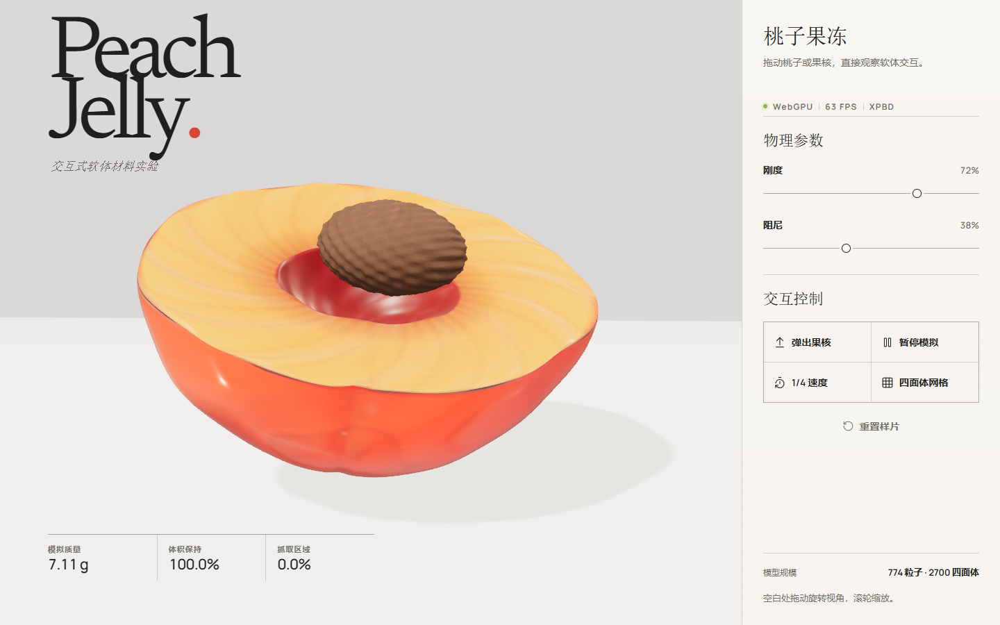
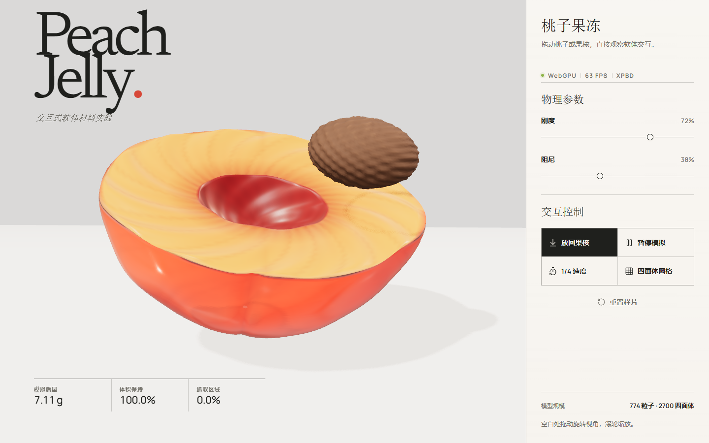
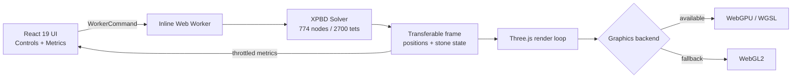
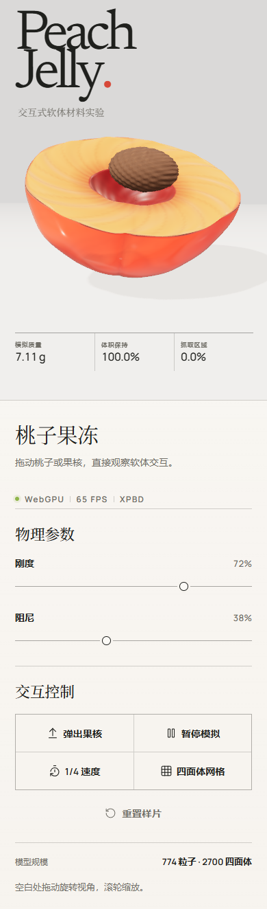
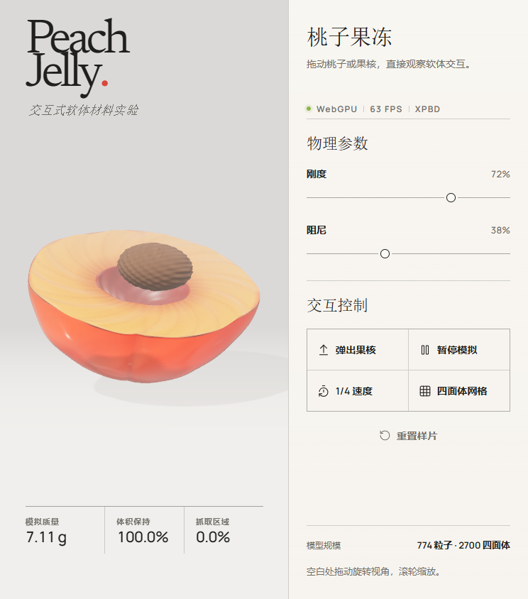

<div align="center">

# Peach Jelly.

### A soft-body material study rendered in the browser.

一个用 WebGPU、程序化几何与 XPBD 物理构建的可交互桃子果冻实验。

**[在线体验 Live Demo](https://qkkooq.github.io/peach-jelly-webgpu/)** · **[查看源码 Source](https://github.com/QkkooQ/peach-jelly-webgpu)**

[](#技术栈)
[](#技术栈)
[](#技术栈)
[](#技术栈)
[](#软体模拟)
[](#技术栈)
[](#质量保障)
[](#license)



</div>

> Drag the jelly. Pull out the stone. Change the material while it is in motion.  
> 拖动果冻、拉出果核，在运动过程中实时改变它的物理响应。

## 这不是一张 3D 效果图

Peach Jelly 是一套真正运行在浏览器里的交互式材料实验。桃子不是视频，也不是预渲染贴图：它的表面来自程序化几何，形变来自约 **774 个粒子和 2700 个四面体**组成的软体求解器，果核是独立刚体，渲染则由 Three.js 的 WebGPU 管线完成。

项目把视觉设计、实时图形、数值模拟和前端工程放在同一个作品里：

- **React 19 + TypeScript**：将界面状态、Worker 协议和渲染生命周期解耦。
- **WebGPU + Three.js**：使用透射、厚度、清漆与体积吸收材质表现果冻。
- **CPU XPBD + Web Worker**：60 Hz、10 子步软体求解，主线程不被物理计算阻塞。
- **程序化资产**：桃子、切面、凹槽、果核与接触阴影均由代码生成。
- **渐进增强**：WebGPU 不可用时自动切换到 WebGL2。
- **真实测试**：Vitest 验证几何与拓扑，Playwright 验证交互和响应式布局。

<details>
<summary><strong>查看交互状态 / Interaction state</strong></summary>
<br />

</details>

## 核心功能

| 能力 | 实现 |
| --- | --- |
| 软体交互 | 拖拽果冻产生局部形变，释放后依靠体积约束与形状匹配回弹 |
| 果核刚体 | 可抓取、拖出、投掷、落地，并拥有独立速度和接触状态 |
| 粘附 / 分离 | “弹出果核”会解除粘附并施加冲量；“放回果核”会柔和复位 |
| 实时物理参数 | 刚度与阻尼滑块直接改变 Worker 中运行的求解器 |
| 时间控制 | 暂停模拟、恢复模拟、切换 1/4 速度 |
| 网格检查 | 显示真实四面体约束边，而不是装饰性线框 |
| 设备降级 | WebGPU 优先，WebGL2 兜底 |
| 响应式界面 | 桌面仪器栏 / 移动端纵向实验页，无横向溢出 |
| 可访问性 | 原生按钮、滑块、键盘视角控制、状态文本与 reduced-motion 支持 |

## 技术栈

| 层级 | 技术 |
| --- | --- |
| UI | React 19、TypeScript strict、CSS |
| 构建 | Vite 8、`vite-plugin-singlefile` |
| 3D | Three.js 0.187、WebGPURenderer、WebGPU / WGSL pipeline |
| 物理 | 自写 CPU XPBD、四面体体积约束、距离约束、形状匹配 |
| 并发 | Inline Web Worker、Transferable typed arrays |
| 测试 | Vitest、Playwright、GitHub Actions |
| 部署 | GitHub Pages |

## 工程亮点

### 1. React 只处理“低频状态”

物理 Worker 每帧都会返回数百个粒子位置，但 React 不会逐帧重渲染。位置数据通过 `Float32Array` 直接进入渲染循环；只有质量、体积、抓取区域和运行状态以约 10 Hz 的节奏更新到界面。这样既保留 React 的可维护性，又避免把实时图形塞进组件状态。

### 2. Worker 协议是可扩展的

模拟器使用明确的可辨识联合命令控制初始化、拖拽、果核弹出、暂停、时间倍率和材料参数。渲染层不需要知道求解器内部如何计算，只需要消费帧数据。

### 3. 表面与体积保持真实关联

每个可见表面顶点绑定到最近的四个软体节点。用户看到的外壳、切面和凹槽形变来自同一套体积求解结果，不是叠加的 CSS 动画。

### 4. 同一套产品体验覆盖两代图形后端

渲染器优先请求 WebGPU，并在不可用时切换到 WebGL2。物理、果核、按钮状态和响应式布局保持相同，避免兼容模式变成不可交互的降级截图。

### 5. 图形、工程与界面被作为一个系统设计

类型尺度、仪器栏密度、材质色彩、阴影方向、按钮状态和物理反馈使用同一套视觉语言。界面上的每个读数都来自正在运行的模拟。

## 架构



### 模拟参数

- 时间步：`60 Hz`
- 子步：`10`
- 软体粒子：`774`
- 四面体：`2700`
- 果核：独立刚体状态与速度
- 交互：射线拾取 → 节点抓取约束 / 果核目标位置
- 体积反馈：对当前四面体体积与静止体积做实时比较

### 渲染参数

- 物理透射材质 `transmission`
- 体积厚度 `thickness`
- 衰减颜色与距离 `attenuationColor` / `attenuationDistance`
- 清漆层 `clearcoat`
- 顶点色材质晕染
- 方向光、接触阴影与动态地面遮蔽

## 本地运行

环境要求：Node.js 20.19+，推荐 Node.js 22。

```bash
git clone git@github.com:QkkooQ/peach-jelly-webgpu.git
cd peach-jelly-webgpu
npm ci
npm run dev
```

生产构建：

```bash
npm run build
```

产物位于 `dist/index.html`，脚本、样式与 Worker 会打包为单个 HTML 文件。

## 操作说明

| 操作 | 结果 |
| --- | --- |
| 拖动桃子 | 抓取局部区域并产生软体形变 |
| 松开桃子 | 根据速度自然回弹 |
| 拖动果核 | 从凹槽拉出并移动 |
| 松开果核 | 投掷、落地或保留在当前位置 |
| 空白区域拖动 | 旋转观察视角 |
| 鼠标滚轮 | 缩放视角 |
| 方向键 | 调整观察角度 |
| 弹出 / 放回果核 | 切换果核分离与粘附状态 |
| 刚度 / 阻尼 | 实时改变物理响应 |
| 暂停 / 1/4 速度 | 控制模拟时间 |
| 四面体网格 | 显示真实求解拓扑 |

## 质量保障

```bash
npm run lint
npm test
npm run test:e2e
npm run build
```

- Vitest：检查晶格规模、索引范围与所有四面体是否存在退化。
- Playwright：检查首屏、完整控制流程、桃子拖拽回弹、移动端无横向溢出以及 WebGL2 降级。
- GitHub Actions：每次推送 `main` 自动构建并部署 GitHub Pages。

当前验证环境：

| 项目 | 结果 |
| --- | --- |
| Edge 144 / WebGPU | 启动成功，桌面 1440×900 实测约 60–63 FPS |
| Edge 144 / WebGL2 fallback | 启动成功，物理与界面可用 |
| Mobile viewport | 390×844 无横向溢出 |
| TypeScript / ESLint / Build | 通过 |
| Vitest | 3 项通过 |
| Playwright | 5 条端到端场景通过 |

帧率会随设备、浏览器、窗口尺寸和电源策略变化，以上数据仅代表本次测试环境。

<details>
<summary><strong>移动端预览 / Mobile preview</strong></summary>
<br />

</details>

<details>
<summary><strong>中等宽度预览 / Compact layout</strong></summary>
<br />

</details>

## 项目结构

```text
src/
├── components/
│   ├── ControlPanel.tsx      # 仪器面板与原生控件
│   └── PeachStage.tsx        # 渲染器、镜头和指针交互
├── scene/
│   ├── geometry.ts           # 桃子、切面、果核与阴影纹理
│   └── skin.ts               # 表面顶点 → 软体节点绑定
├── simulation/
│   ├── lattice.ts            # 程序化节点、边和四面体拓扑
│   ├── peachWorker.ts        # XPBD、拖拽、果核与指标
│   ├── types.ts              # Worker 协议和 UI 类型
│   └── workerClient.ts       # Worker 生命周期封装
├── App.tsx                   # 页面状态编排
└── styles.css                # 设计系统与响应式布局
```

## English overview

Peach Jelly is an interactive WebGPU material study built with React 19, TypeScript, Three.js, and a custom XPBD soft-body worker. The visible peach surface is skinned to a procedural tetrahedral lattice, while a separate rigid peach stone can be grabbed, thrown, detached, and reseated. The application presents live simulation readouts through a restrained laboratory-style interface and falls back to WebGL2 when WebGPU is unavailable.

### Highlights

- Real-time soft-body deformation powered by CPU XPBD and transferable Worker frames
- About 774 particles and 2700 tetrahedra, generated entirely in code
- Physically based transmission material with thickness and attenuation
- Pointer interaction, camera controls, simulation speed, grid inspection, and reset
- Responsive desktop/mobile composition with accessible native controls
- Unit, browser, and deployment automation with Vitest, Playwright, and GitHub Actions

### Quick start

```bash
npm ci
npm run dev
```

## Known limitations

- 果核碰撞使用轻量椭球接触近似，没有实现桃子软体自碰撞或真实切割。
- 当前软体求解运行在 CPU Worker；将约束迁移到 WebGPU compute shader 是后续性能方向。
- 透射材质的实际视觉效果会随浏览器和 GPU 驱动略有差异。
- 项目优先面向桌面交互体验，移动端可完整运行，但高密度网格和 WebGPU 效果取决于设备能力。

## License

[MIT](./LICENSE) © 2026 [Sun Feiyu / QkkooQ](https://github.com/QkkooQ)
